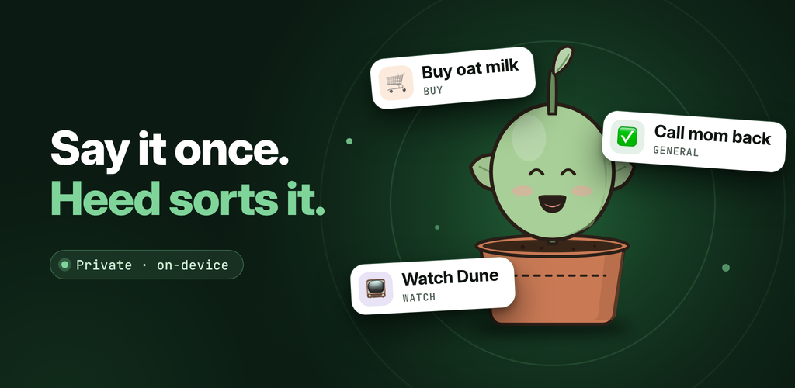
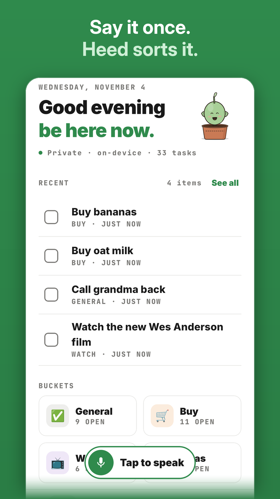
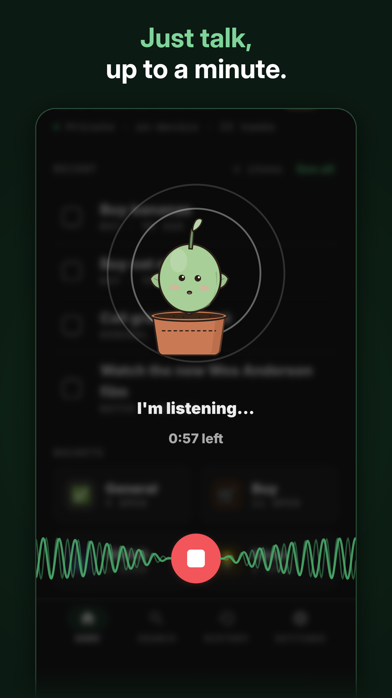
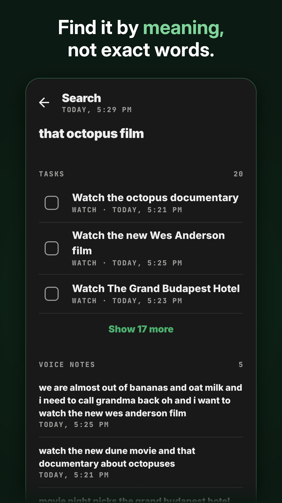

<p align="center">
  
</p>

<h1 align="center">Heed</h1>

<p align="center"><b>Say it once. Heed sorts it.</b><br>Voice notes to tidy lists, fully on your phone.</p>

<p align="center">
  <a href="https://play.google.com/store/apps/details?id=com.heedapp.android"></a>
</p>

<p align="center">
  <a href="https://huggingface.co/mohitkrconnect/heed-tasks-qwen3-0.6b"></a>
  <a href="https://huggingface.co/datasets/mohitkrconnect/heed-voice-notes-to-tasks"></a>
  <a href="https://huggingface.co/spaces/mohitkrconnect/heed-study"></a>
  <a href="LICENSE"></a>
</p>



<p align="center">
  
  
  
  
</p>

Heed is an Android app that turns voice notes into tidy lists. You talk the way you would to a friend ("we're out of olive oil and eggs, oh and I have to call mom back"). Heed writes it down, splits it into separate items and puts each one in the right bucket: things to do, things to buy, shows to watch, ideas, work and journal entries. You can then search your notes by meaning or by date.

Website: [heed-xi.vercel.app](https://heed-xi.vercel.app)

## Results in one look

The task model is a fine-tuned **Qwen3-0.6B** that runs offline on the phone CPU. On a sealed test of 617 notes (126 of them real), run once, int8, on a real phone:

- **80% of Claude Sonnet 5.5's quality** (judged task F1 75.6 against 94.8), and 84% on the real notes.
- **20 points ahead of GPT-5.4 mini** [95% CI +17.0, +23.0]. A second judge from another model family agrees on the order.
- **5.1 s per note** (median) on a MediaTek Dimensity 8300 CPU. The model file is 614 MB.
- Search: **+49% nDCG@10** over keyword search alone, at 27 ms per search.

Claude Haiku 5.5 and Gemini 3.5 Flash are still better. This is a 0.6B model on a phone, not a frontier model.

## Private by construction

Heed does not ask for the internet permission, so Android itself keeps it offline. There is no account, no analytics, no ads and no server. Speech recognition, sorting and search all run on the phone, and your notes stay in the app's private storage. You can export a backup file yourself and restore it on a new phone.

## How it works

Three small models run on the phone's CPU, one at a time (each unloads after 90 s idle):

| Step | Model | Runtime |
|---|---|---|
| Voice to text | [Granite Speech 5.0 470M TurboCTC](https://huggingface.co/ibm-granite/granite-speech-5.0-470m-turboctc) (IBM), int8 | LiteRT |
| Text to items | [heed-tasks-qwen3-0.6b](https://huggingface.co/mohitkrconnect/heed-tasks-qwen3-0.6b), Qwen3-0.6B fine-tuned for Heed, int8 | LiteRT-LM |
| Search | [EmbeddingGemma 300M](https://huggingface.co/onnx-community/embeddinggemma-300m-ONNX) (Google), 4-bit | ONNX Runtime |

- A note of up to a minute is transcribed to lowercase text without punctuation. The task model gets a raw prompt (the bucket list plus the note, no chat template) and writes compact JSON: `{"tasks":[{"t":"...","c":"..."}]}`.
- The answer is streamed through a small guard that stops when the JSON closes, at 400 pieces, or when a task repeats three times, and keeps only well-formed rows. If nothing is readable, a simple rule-based parser saves the note, and the model sorts it again the next time the app is open.
- Search combines keyword ranking (SQLite FTS5, BM25) with EmbeddingGemma vectors through weighted reciprocal rank fusion, then applies date phrases such as "yesterday" or "last week".
- On Google Play the three models ship as install-time AI packs (`task_model`, `speech_model`, `search_model`). The app works the moment it is opened and never downloads anything itself.

The code is Kotlin with Jetpack Compose, Room, Koin and WorkManager.

## How the task model was made

Full details, with every experiment and decision, are in the [Heed study](https://huggingface.co/spaces/mohitkrconnect/heed-study) and the [model card](https://huggingface.co/mohitkrconnect/heed-tasks-qwen3-0.6b).

**Data.** 8,610 training notes, each used twice: once as written and once in the speech-like "plain" form (lowercase, no punctuation), so 17,220 rows. Training on both forms cut the drop on unpunctuated input from 5.7 points to 0.2. Most notes are synthetic, written by Claude, Gemini and GPT models with personas, situations and speaking styles: long rambling brain dumps, self-corrections, notes with nothing to do, speakers from 16 English-speaking countries, and 1,696 notes written on purpose to fix errors found in a review. 150 real notes from me and five friends were also used for training; they are not published. Validation has 451 notes and the sealed test 617.

**Labels.** Every note was labelled by Claude Sonnet 5.5 at temperature 0 under one frozen labelling prompt, so the whole set follows one style. Spoken times stay inside the task text instead of separate fields. The model never creates reminders; in the app they are set by hand.

**Training.** Full fine-tune of [Qwen3-0.6B-Base](https://huggingface.co/Qwen/Qwen3-0.6B-Base), loss on the answer tokens only. AdamW, learning rate 1e-5 with warm-up and cosine decay, 16 rows per step, 3 epochs, 1,024-token context, bf16 on a single RTX 4090. The epoch is chosen by task score on validation, not by loss. The weights were exported with `litert-torch` to an int8 `.litertlm` file for LiteRT-LM.

**Evaluation.** Word overlap with the label punishes correct answers worded differently, so every system is scored by a blind LLM judge, Gemini 3.1 Pro. It sees only the note and an anonymous task list, and marks each task good, fixable or wrong, plus the tasks that were missed:

- precision = good / (good + fixable + wrong)
- recall = good / (good + fixable + missed)
- F1 = 2PR / (P + R)

Before use, the judge was tested against planted errors (96% caught), against itself (96.2% repeatable), against GPT-5.4 (κ 0.63) and against my own blind ratings (κ 0.84). Intervals come from a paired bootstrap over notes.

| System (sealed test, 617 notes) | Judged task F1 | F1 on 126 real notes |
|---|---|---|
| Claude Sonnet 5.5 (wrote the labels) | 94.8 | 95.1 |
| Gemini 3.5 Flash | 91.8 | 94.2 |
| Claude Haiku 5.5 | 85.6 | 92.0 |
| **Heed, Qwen3-0.6B int8 on the phone** | **75.6** | **80.1** |
| GPT-5.4 mini | 55.5 | 75.3 |

Known weak spots: long, chatty notes (F1 70.5 on 40 to 99 word notes), small buckets such as Watch and Journal, and details that get lost in long answers. The labels come from one model family, and the test relies on an LLM judge checked against a human.

## On Hugging Face

Everything in one place: [Heed collection](https://huggingface.co/collections/mohitkrconnect/heed-on-device-voice-notes-to-tasks-6aeb1f235223a590f0929743)

- **Blog:** [Heed study](https://huggingface.co/spaces/mohitkrconnect/heed-study), how the model was built and evaluated
- **Dataset:** [heed-voice-notes-to-tasks](https://huggingface.co/datasets/mohitkrconnect/heed-voice-notes-to-tasks), synthetic notes and labels, test answers with the judge's verdicts, and the scoring script
- **The app model:** [heed-tasks-qwen3-0.6b](https://huggingface.co/mohitkrconnect/heed-tasks-qwen3-0.6b)

Research checkpoints, including failed experiments:

| Model | What it is |
|---|---|
| [heed-tasks-qwen3-0.6b-seed0](https://huggingface.co/mohitkrconnect/heed-tasks-qwen3-0.6b-seed0) | Same recipe, other seed |
| [heed-tasks-qwen3-0.6b-exp054](https://huggingface.co/mohitkrconnect/heed-tasks-qwen3-0.6b-exp054) | Previous app model, without the targeted notes |
| [heed-tasks-only-qwen3-0.6b](https://huggingface.co/mohitkrconnect/heed-tasks-only-qwen3-0.6b) | First model on the phone |
| [heed-tasks-only-qwen3.5-0.8b](https://huggingface.co/mohitkrconnect/heed-tasks-only-qwen3.5-0.8b) | 0.8B, not shipped |
| [heed-tasks-only-long-qwen3-0.6b](https://huggingface.co/mohitkrconnect/heed-tasks-only-long-qwen3-0.6b) | Tasks only, with long notes |
| [heed-full-output-json-qwen3-0.6b](https://huggingface.co/mohitkrconnect/heed-full-output-json-qwen3-0.6b) | Task, bucket, time and reminder as JSON |
| [heed-full-output-lines-qwen3-0.6b](https://huggingface.co/mohitkrconnect/heed-full-output-lines-qwen3-0.6b) | The same in a lines format; lost to JSON |
| [heed-full-output-json-4ep-qwen3-0.6b](https://huggingface.co/mohitkrconnect/heed-full-output-json-4ep-qwen3-0.6b) | 4-epoch JSON baseline |
| [heed-simnotes-e2-qwen3.5-0.8b](https://huggingface.co/mohitkrconnect/heed-simnotes-e2-qwen3.5-0.8b) | Trained on simulated notes; no gain |
| [heed-simnotes-soup-qwen3.5-0.8b](https://huggingface.co/mohitkrconnect/heed-simnotes-soup-qwen3.5-0.8b) | Weight average of two runs |

## Building it

You need JDK 17 or newer and the Android SDK (compile SDK 36). The app targets Android 16 and runs on Android 10 (API 29) or newer with 6 GB of RAM or more.

The model files are not in this repository. Put them here before building:

| File | Where it comes from |
|---|---|
| `task_model/src/main/assets/models/q06_t061s1e3.litertlm` | `heed-tasks-qwen3-0.6b-int8.litertlm` from [heed-tasks-qwen3-0.6b](https://huggingface.co/mohitkrconnect/heed-tasks-qwen3-0.6b), renamed (sha256 `6f363164…09cc`) |
| `search_model/src/main/assets/models/egemma300m_q4/` | `model_q4.onnx`, `model_q4.onnx_data` and `tokenizer.json` from [onnx-community/embeddinggemma-300m-ONNX](https://huggingface.co/onnx-community/embeddinggemma-300m-ONNX), unchanged |
| `speech_model/src/main/assets/models/granite_speech_ctc_wi8fc.tflite` and `vocab_hex.txt` | An int8 LiteRT conversion of [Granite Speech 5.0 470M TurboCTC](https://huggingface.co/ibm-granite/granite-speech-5.0-470m-turboctc) and its vocabulary |

```bash
./gradlew :app:assembleDebug        # debug APK with the models inside
./gradlew :app:installDebug         # install on a connected phone
./gradlew :app:testDebugUnitTest    # unit tests
./gradlew :app:bundleRelease        # Play bundle with the AI packs (needs your own signing key in local.properties)
```

## License

The code is released under the [Apache License 2.0](LICENSE).

The models keep their own licenses: the Heed task model, Qwen3 and Granite Speech are Apache 2.0, and EmbeddingGemma is under the [Gemma Terms of Use](https://ai.google.dev/gemma/terms). The dataset is CC-BY-4.0. The bundled fonts, Inter and JetBrains Mono, are under the SIL Open Font License 1.1. The app's Settings show every license in full.
